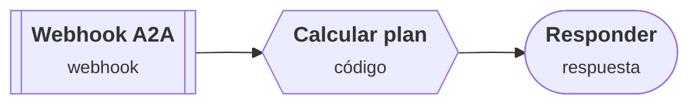
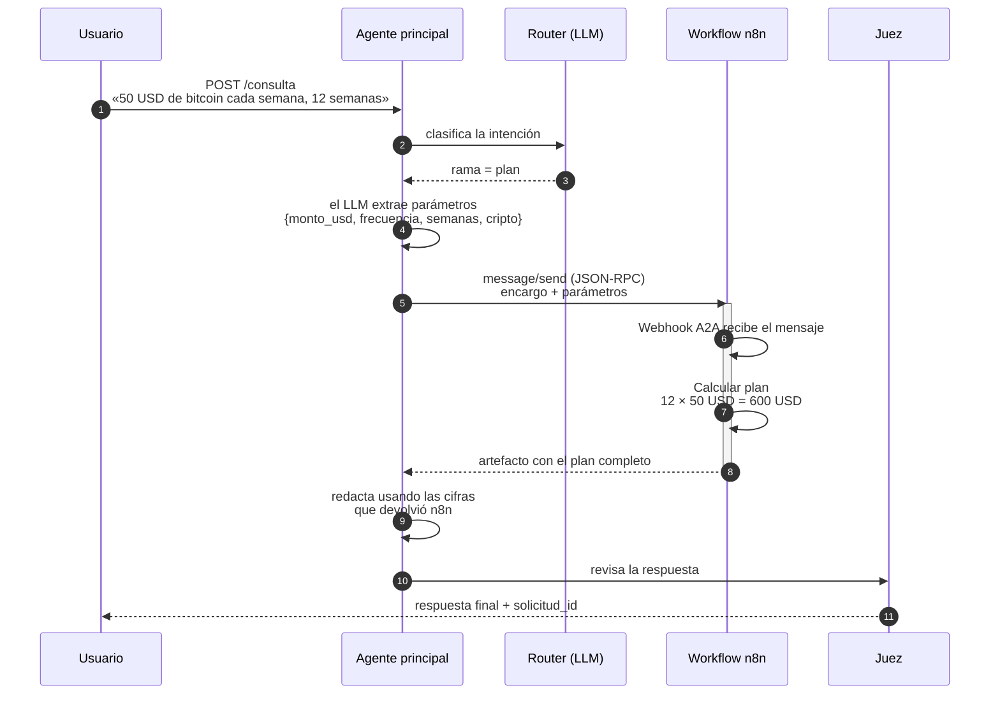

# El flujo de n8n, en diagramas

Este documento describe el especialista A2A que vive en n8n. Los diagramas se
generan desde el propio artefacto que se importa en n8n
(`n8n/a2a-plan-dca.json`), no se dibujan a mano:

```powershell
python scripts/diagrama_n8n.py
```

Así el diagrama no puede quedar desactualizado respecto del workflow real: si
alguien añade un nodo o cambia una conexión, se regenera y el cambio aparece en
el diff.

## Verlo en el lienzo de n8n

La imagen más fiel es el editor de n8n:

1. Abre <http://127.0.0.1:5678> con n8n corriendo.
2. La primera vez pide crear una cuenta local (nombre, correo y contraseña).
   Es solo de tu máquina; no se envía a ningún lado.
3. En la lista de workflows abre **A2A · Plan de compra periódica (DCA)**.

Ahí ves los tres nodos conectados, y sobre cada ejecución puedes abrir el panel
de *Executions* para inspeccionar la entrada y la salida real de cada paso.

## Diagrama de nodos



| Nodo | Tipo | Qué hace |
|---|---|---|
| **Webhook A2A** | `webhook` | Expone `POST /webhook/a2a-plan`. Espera recibir un JSON-RPC `message/send` y no responde por su cuenta: delega la respuesta al nodo final. |
| **Calcular plan** | `code` | Extrae el bloque JSON de parámetros del texto del encargo, valida los rangos y arma el plan: una entrada por compra con su acumulado. Si los parámetros faltan o están fuera de rango, devuelve un error JSON-RPC `-32602` sin ejecutar nada. |
| **Responder** | `respondToWebhook` | Devuelve al agente principal el objeto que produjo el nodo anterior, con la forma de tarea A2A (`kind: task`, `status.state: completed`, `artifacts`). |

## Recorrido completo del encargo

Este segundo diagrama incluye a las dos partes: el agente principal y el
especialista en n8n.



El reparto de responsabilidades es deliberado: **el LLM interpreta y redacta, n8n
calcula**. La redacción final se construye a partir del artefacto, no se le pide
al modelo que "cuente" el plan, para que no pueda alterar las cifras.

## El contrato del mensaje

Lo que el agente principal envía:

```json
{
  "jsonrpc": "2.0",
  "id": "aae6a73d-0749-4a9d-a75e-d9ce6badf8ed",
  "method": "message/send",
  "params": {
    "message": {
      "role": "user",
      "messageId": "aae6a73d-0749-4a9d-a75e-d9ce6badf8ed",
      "parts": [
        {
          "kind": "text",
          "text": "Armar un plan de compra periódica.\nParámetros: {\"monto_usd\":50,\"frecuencia\":\"semanal\",\"semanas\":12,\"cripto\":\"bitcoin\"}"
        }
      ]
    }
  }
}
```

Lo que n8n devuelve (recortado; el artefacto completo trae las 12 compras):

```json
{
  "jsonrpc": "2.0",
  "id": "aae6a73d-0749-4a9d-a75e-d9ce6badf8ed",
  "result": {
    "kind": "task",
    "id": "n8n-aae6a73d-0749-4a9d-a75e-d9ce6badf8ed",
    "status": { "state": "completed" },
    "artifacts": [
      {
        "artifactId": "plan-dca",
        "parts": [
          {
            "kind": "text",
            "text": "{\"tipo\":\"plan_dca\",\"cripto\":\"bitcoin\",\"monto_usd\":50,\"semanas\":12,\"compras\":12,\"total_usd\":600,\"plan\":[{\"numero\":1,\"monto_usd\":50,\"acumulado_usd\":50}, ... ]}"
          }
        ]
      }
    ]
  }
}
```

## Diferencias con el especialista obligatorio

Los dos hablan A2A, pero resuelven casos distintos a propósito:

| | Especialista LangGraph (`:2024`) | Especialista n8n (`:5678`) |
|---|---|---|
| Criterio de la pauta | Delegación A2A **obligatoria** | Flujo A2A **adicional** (+1,0) |
| Qué resuelve | Conceptos del manual, con RAG y fuentes | Cálculo de un plan de aportes periódicos |
| Cómo responde | LLM + recuperación semántica | Código determinista en JavaScript |
| Descubrimiento | `POST /assistants/search` | URL de webhook fija |
| Tiene LLM propio | Sí | No: solo calcula |

## Comprobarlo sin abrir el editor

```powershell
python scripts/probar_n8n.py
```

Envía un `message/send` real y verifica que el artefacto traiga 12 compras y un
total de USD 600. Es la misma comprobación que hace `evidencias/pruebas_base.py`
dentro de la suite completa.
